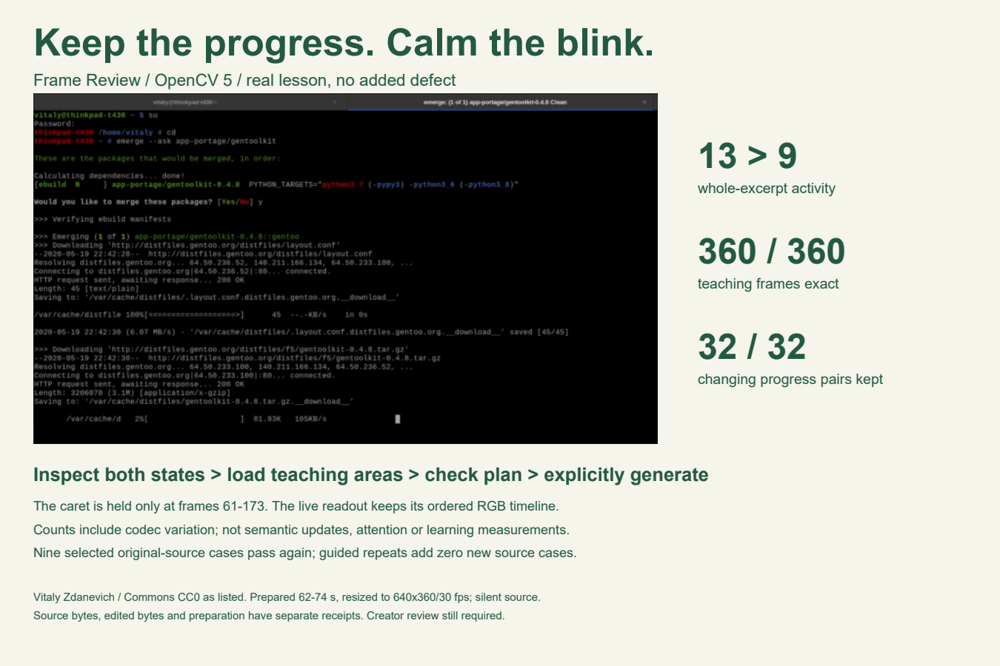

# Frame Review: Keep the Lesson

**Keep your recording when analysis hits a limit.** V19 adds a recovery card for the sixteen-region refusal: download the retained original/prepared excerpt and set up a four-second range without losing the selected file. Setup never uploads, analyzes or approves an edit; the creator explicitly analyzes again. Fixed-frame teaching comparison, 100%/200% inspection and V18 pan retention remain.

[Live app](https://le-d72c965de52749b08fd72a2513bccce1.ecs.us-east-1.on.aws/) · [Current four-page report](docs/real-lessons-report.pdf) · [Evidence and reproduction](docs/proof-v19/REPRODUCE.md).

Both real jEdit failures at 95/176 seconds complete the actual browser 12-second refusal → four-second retry → review with zero proposals. Original/prepared downloads verify; no edit approval or newly repaired lesson is claimed. The card fits an actual 375px browser viewport. No physical-phone or fresh Brave qualification. All 14 Linux stages, 137 backend/132 studio tests (one skip), three native and current HTTPS regressions pass. The 108 media/PNG regression members match V18; frozen engine, boundary renderer and study files are unchanged.

Fourteen new fixed Sed/Lynx windows reach review with zero proposals and exact source recovery. Combined exploratory evidence retains 56 windows across seven new lesson titles and one repeated bootcamp source, including negative/refused cases. Overlap, shared creators and sequential selection limit independence. No new useful repair or human benefit is demonstrated.

The prospective [reading/preference pilot](human-study/) still has zero valid humans in its dated aggregate, with QA excluded and team responses separate. [Devpost volunteer discussion](https://opencv26.devpost.com/forum_topics/45681-3-4-minute-lesson-clip-study-looking-for-adult-volunteers).

After preserving QA evidence, the identical image is activated cleanly; final identity/health and earlier same-image full qualification have separate receipts. Direct default-branch pushes; no cron. The demo waits for creator audio.

## Historical version notes

Historical v10 preserved every original color sample and required exact RGB outside the actual caret box. Eleven selected original-source exports passed on that runtime; [v10 evidence](docs/natural-v10/REPRODUCE.md) remains version-specific.

Current v9 adds supported Ogg/Theora lesson intake and reversible two-corner teaching-area marking. All 14 stages, 137 backend tests and 106 studio tests pass (one platform skip). Ten new source recordings / 48 total windows are retained, including an explicitly exploratory pause search; one new Joomla natural-caret repair independently qualifies. The historical nine-source baseline stays separate. See [v9 reproduction](docs/natural-v9/REPRODUCE.md) and [current evidence](evidence/natural-v9/release-binding.json). No demo, narration or submission-video update.

The following material includes historical v8/v7 evidence; its labeled results remain version-specific.

**Current app update (v8): edit a teaching box in place.** Choose **Edit** beside a saved area, adjust its name or rectangle, then **Save area changes** or **Cancel area changes**. The overlay previews the draft; invalid input keeps the saved box. Editing works at the four-area limit and requires a fresh plan and consent. Suggested areas now appear above the source image. No voice or submission-video change.

**Keep the progress. Calm the blink.** A teacher has a finished recording and no editable project. During a reading pause, a caret blinks beside a changing package-download readout. Frame Review lets the editor hold that observed caret state while the teaching content keeps its original prepared timeline.

[Try the AWS app](https://le-d72c965de52749b08fd72a2513bccce1.ecs.us-east-1.on.aws) · [Devpost entry](https://devpost.com/software/countback-inspect-the-evidence) · [Current report](docs/real-lessons-report.pdf) · [Exact release evidence](evidence/natural-v8/release-binding.json)

## A judge can try the hard part first

1. Select **Package progress · keep the readout moving**, then **Try the real package-progress lesson**. This is a prepared real Gentoo tutorial; no defect was added.
2. Inspect both observed caret states. Choose **Load this example's teaching areas**: commands, live progress and lower margin appear on the static image. Use **Edit** beside an area to adjust it; save or cancel before checking the plan.
3. **Check edit plan**, explicitly tick review, then **Generate comparison**. Loading suggestions never checks the plan or approves the edit.
4. Inspect all four cut moments and expand the live-progress teaching proof. Download the report, recipe and actual comparison; play it before use.

The selected blink changes **4 → 0** inside the hold; whole-excerpt activity is **13 → 9**, including cuts, with zero new threshold events. The adjacent progress crop retains **32 of 112 changing frame pairs** during that hold. All **360 ordered teaching RGB frames** match exactly. Counts include codec variation; they are not 32 semantic updates or evidence of learning benefit. Gentoo is silent and stays silent. [Credit and original/prepared hashes](studio/fixtures/NATURAL_GENTOO_CREDIT.json).

## The creative choice: prove what must keep moving

OpenCV 5 measures stationary two-state regions with temporal image differences and connected components. The editor decides whether a candidate is incidental. A source-matched cut policy shortens a hold rather than hiding a worse return behind a lower count. Export checks actual native samples, decoded RGB, timestamps, audio and cut points. Ordered teaching-region digests and actual hash-bound PNG pairs make a frozen or reordered explanation fail.

This release makes that evidence usable: the strongest real case is the default; three known prepared examples have source-and-candidate-bound teaching-area suggestions. A different hash or candidate receives no template. Suggestions do not recognize arbitrary semantic content, overwrite custom areas, check a plan or grant consent. Unknown uploads retain manual marking. Four-area limit and overlap refusals remain enforced.

## Evidence, with the selection boundary visible

**Current v8: all 14 verification stages pass**, including **137 backend tests** and **100 studio tests** (one platform skip). An untouched Gentoo original also passes independent HTTP/native/RGB/audio/timing/cut/teaching-proof checks after widening its saved progress area from 360 to 364 pixels. The first preparation timeout is retained; the isolated retry passed with the same limit. The nine-source full original regression below is the **v7 baseline**, not nine new v8 jobs. Media, detector, teaching and cut engines are byte-identical; no tolerance or deadline was relaxed. There are zero new natural-source qualifications.

**Selected-source baseline from v7:**

| Real lesson | Whole 12-second source → edit activity | Inside hold |
|---|---:|---:|
| Jupyter notebook | 24 → 18 | 4 → 0 |
| npm packages | 19 → 13 | 5 → 0 |
| npm basics | 17 → 11 | 5 → 0 |
| Wikipedia link | 9 → 3 | 4 → 0 |
| Wikipedia citations | 6 → 2 | 4 → 0 |
| Tamil terminal | 15 → 9 | 4 → 0 |
| Gentoo package progress | 13 → 9 | 4 → 0 |
| Writer lesson | 15 → 9 | 6 → 0 |
| Portuguese Wikipedia caption | 17 → 11 | 5 → 0 |

Activity counts adjacent selected-box mean RGB changes ≥8 codes. All nine retain zero new event times and pass strict encoded boundary checks. Existing strong source transitions can remain. Nine selected sources are not nine independent creators, a recall estimate or a user study.

The earlier exploratory screen of 11 additional originals / 33 fixed windows and three real teaching-overlap refusals remains in [v6 evidence](evidence/natural-v6/). First seven/21 ran on v5; second four/12 was exploratory follow-up. Negative and rapid-change outcomes stay visible. The same-72-second six-source comparison remains source / untuned 5×5 sigma2 blur / older hold / matched hold **90 / 91 / 54 / 56**. Matched holds remove 34 (37.8%) without new events; old holds introduce events in five cases. This is not a professional-editor or human-benefit comparison. [v5 traces](evidence/natural-v5/comparison.json).

## Reproduce and inspect

Build on Linux: `docker build -t frame-review .`

Run a fresh gate: `docker run --name frame-review-v7-check --network none frame-review python studio/run.py --verify /tmp/qualification`, then `docker cp frame-review-v7-check:/tmp/qualification ./qualification`.

Serve: `docker run --rm --network host frame-review python studio/run.py --serve --port 8877`; open http://127.0.0.1:8877 on that host. Windows source/UI tests alone do not qualify media. The exact runtime manifest is `17a7f5cdfae01949b1a07baf7b3f3fa0fe2104927f99d90e212500c666c91801` (113 files). Original-source harnesses and guide contracts are in [reproduction notes](docs/natural-v8/REPRODUCE.md); original URLs, authors, listed licenses and preparation adaptations remain in evidence/natural-v6/sources.json.

The local release-browser adapter is explicitly local evidence. Current AWS qualification is recorded separately in evidence/natural-v8/cloud-verified.json. The prior v6 cloud caption preparation differed across hosts and was independently checked against its actual cloud reference; no universal preparation-byte determinism claim is made.

## Impact hypothesis and practical limits

The useful creator task is rescuing a small reading pause without re-recording a finished lesson. We demonstrate bounded edit, recoverable source, unchanged declared teaching samples and a reviewable export. We have not measured creator preference, task time, attention, comprehension, accessibility, adoption or safety. The next useful evidence is consenting teacher/editor tasks with blinded original/edit preference and timed rescue attempts.

Original SDR recordings are limited to 64 MiB; preparation extracts 1–12 seconds at 640×360/30 fps and optional mono AAC, and may reduce legibility. Exact edit comparisons reference the prepared clip, with original bytes retained separately. No full-lesson splice-back, moving semantic tracking, automatic publishing decision or original-resolution guarantee is implemented. One 1-vCPU/2-GiB AWS task, one worker, eight retained jobs; 24-hour expiry or earlier restart loss. Download what matters. Listed media licenses and adaptations are preserved; metadata is not independent clearance or endorsement.

The existing 2:46 neural-narrated demo shows an earlier workflow. Current proof is the live app, report, source and receipts. Real voice remains deferred. No special-award capability, judge score or win is claimed. Direct default-branch release; no cron or PR.
