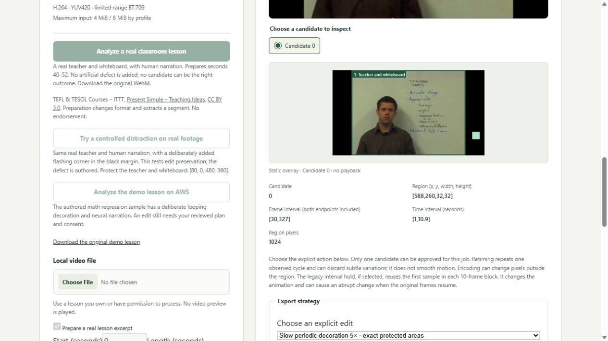

# Frame Review: Keep the Lesson

**Keep the teaching. Slow the distraction.** Upload a real lesson, choose a short excerpt, mark the content that must stay unchanged and inspect a measured local edit.

[Earlier AWS app](https://le-d72c965de52749b08fd72a2513bccce1.ecs.us-east-1.on.aws) · [Devpost entry](https://devpost.com/software/countback-inspect-the-evidence)

**Release status, 23 October:** the real-lesson candidate passed all ten stages and actual local browser checks, including original 1080p AV1 upload, no-edit recovery, real-classroom export, twelve crops, downloads and playback. The public AWS endpoint still serves the earlier authored-lesson release. Deployment of this candidate and its final AWS browser checks await refresh of the existing account credentials. The instructions below describe the candidate you can reproduce locally; its new buttons are not yet on the public endpoint.



Actual local candidate, not the current AWS deployment. ITTT classroom footage, CC BY 3.0; the challenge deliberately adds the corner artifact. No endorsement. [Technical report](docs/real-lessons-report.pdf) · [Real lesson provenance](docs/real-lesson-evaluation.md)

## Try real lesson intake

Use an MP4/MOV or WebM you own or have permission to process, up to **64 MiB**. Keep **Prepare a real lesson excerpt** checked, choose its start (0–600 seconds) and length (1–12 seconds), then analyze. Source files may be up to 30 minutes; this release edits the selected segment and does not splice it back into a full lesson.

Preparation accepts one 8-bit SDR video track, at most one mono/stereo audio track, and dimensions up to 3840×2160. Supported codec families are H.264, SDR HEVC, VP8, VP9, AV1 and MPEG-4, with supported AAC/Opus/Vorbis/MP3/PCM audio. Not every combination has been tested. HDR/high-bit-depth video, subtitles/data tracks, unsupported audio and out-of-bounds excerpts are refused.

Preparation selects the excerpt, preserves its aspect ratio with letterboxing to 640×360, converts to 30 fps and encodes its audio once as AAC-LC mono/48 kHz. **This changes picture and audio.** The uploaded original is kept separately. Exact edit preservation is measured against the prepared clip, not against the original upload. Download both sources and the preparation receipt.

The app also offers two distinct real-footage examples:

- **Analyze a real classroom lesson:** the unmodified ITTT classroom original, preparing seconds 40–52. The tested excerpt produced no candidate; choosing Leave unchanged retains it without inventing an edit.
- **Try a controlled distraction on real footage:** the same real teacher and human narration with an explicitly added flashing corner in the black margin. The defect is authored. Protect **[80, 0, 480, 360]**, name it Teacher and whiteboard, add the area, check the plan and explicitly approve. The exact gate covers all 360 frames of that region. Inspect twelve boundary crops and download the edited segment, sources, recipe, report and preparation receipt.

The authored math clip remains a separate regression demonstration. No source selection or preparation approves an edit. A protected area overlapping the edit is refused. Changing an area invalidates consent and the old plan. Reload reopens a job without repeating its decision; unsaved areas and consent clear.

## Evidence

The classroom WebM is 854×480, 29.97 fps with stereo Vorbis; the separate Wikipedia screencast is 1920×1080, 60 fps, AV1 with stereo Vorbis. Both original excerpts reached review and were left unchanged. Their original-upload downloads matched the original SHA-256. Independent source-to-prepared narration correlation was 0.99604 and 0.99975, with zero best lag within a ±10 ms search; preparation remains lossy.

The augmented classroom challenge passed independent native outside-sample/mapping checks, all 360 teacher/whiteboard RGB-frame comparisons, prepared-narration PCM comparison and all twelve response-PNG hashes. The editor additionally checks AAC packet/timing/skip metadata. This demonstrates functional preservation on real footage with an added test defect; it does not establish repair success on naturally defective lessons or teacher benefit.

See `docs/real-lesson-evaluation.md`, `evidence/real-lessons.json`, `evidence/verification.json` and `evidence/release-binding.json` for source provenance, exact build identity, refusal cases and receipts. The core media algorithms and historical negative evidence remain unchanged. No historical hash gate has been weakened.

## Reproduce

```sh
docker build -t frame-review .
docker run --name frame-review-check --network none frame-review python studio/run.py --verify /tmp/qualification
docker cp frame-review-check:/tmp/qualification ./qualification
docker run --rm --network host frame-review python studio/run.py --serve --port 8877
```

Open http://127.0.0.1:8877 on the Linux Docker host. Media operation requires Linux resource/process controls. Keep processing on native Linux storage; a retained Windows-bind-mount failure hit an unchanged time limit. Copy receipts out after completion. Windows can run source/UI tests, not the media worker. Ten verification stages include the original numerical/refusal suites, authored math lesson, real-classroom preparation/augmented challenge, and studio checks. Exact dependencies and binary hashes are pinned by the Dockerfile and runtime lock.

The external two-source test is reproducible with `docs/fetch-real-evaluation-sources.py` and `python studio/tests/integration_real_lessons.py NEW_OUTPUT_DIRECTORY ORIGINALS_DIRECTORY` in the pinned image. The included classroom original and controlled challenge carry ITTT attribution and CC BY 3.0; external Wikimedia media has its separate attribution/license record. These media licenses do not license third-party dependencies or change the project's source-code notice.

## AWS and limits

ECS/Fargate executes preparation, OpenCV analysis and FFmpeg export behind HTTPS; ECR holds the digest-pinned image and CloudWatch logs the service. See `docs/DEPLOYMENT.md`. The application runs as unprivileged UID 10001, has no AWS API permissions, processes media serially, restricts preparation protocols to file/pipe and applies process/time/memory/disk and upload caps. Job ownership uses Secure/HttpOnly/SameSite cookies plus host/origin/request-token checks. It retains at most eight jobs; uploads and results expire after 24 hours and task replacement can clear them sooner. Download results you need.

The frozen multimedia stack has known package-scan findings. Unprivileged operation and input restrictions are mitigations, not a security certification. Fixed rectangles do not track objects or establish readability. Repeating a cycle may discard small variations; entry/exit transitions remain for review. Adjacent unprotected RGB pixels can differ through chroma interpolation. No safety, medical or publishing-clearance claim is made.

Developed by Joseph Ayanda with AI assistance. The classroom and screencast use their original human narration. The older 2:46 demonstration uses disclosed neural narration and shows the earlier core workflow; a final demo with Joseph's real voice is deferred at his request. Real creator trials and competent manual-editor comparisons remain unperformed.
