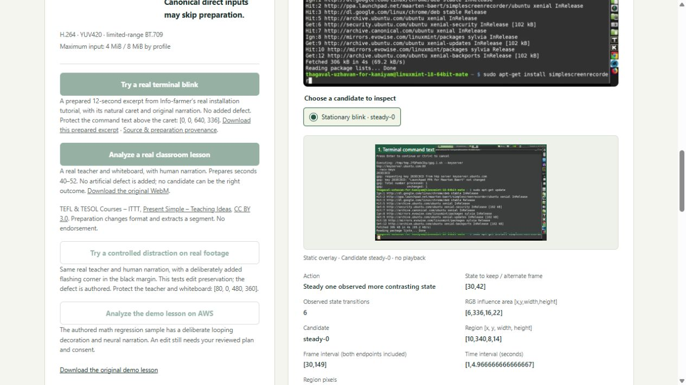
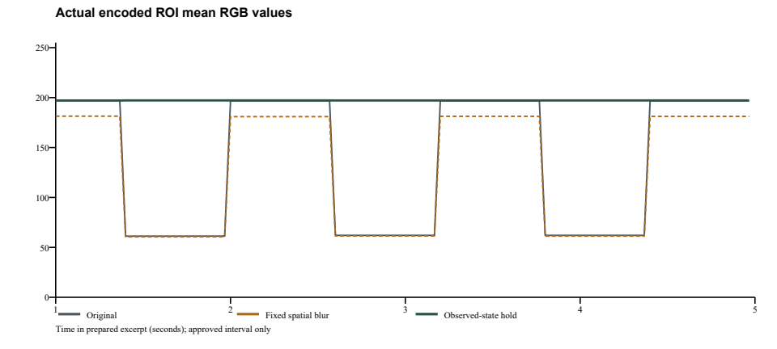

# Frame Review: Keep the Lesson

**Keep the command. Calm the blink.** A teacher has a flattened recording and no editable project. Frame Review steadies an observed blinking detail during a stationary pause, while checking that the teaching text, timeline and prepared narration stay intact.

[Live AWS app](https://le-d72c965de52749b08fd72a2513bccce1.ecs.us-east-1.on.aws) · [Devpost entry](https://devpost.com/software/countback-inspect-the-evidence) · [Technical report](docs/real-lessons-report.pdf)

**Verified 23 October:** one naturally blinking lesson case now completes original upload → preparation → reviewed plan → export → downloads on the public HTTPS app. Six adjacent ROI-mean changes became zero inside the approved four-second interval. All 360 protected teaching frames and prepared audio passed their checks. The AWS output matches the independently decoded local output byte for byte. This is one targeted case, not a user study or a general success rate.



Info-farmer’s real installation tutorial, CC0 1.0. The excerpt was extracted/resized/re-encoded; **no defect was added**. The prepared preset is the same case, not another independent natural success.

## Try the natural repair

1. Open the live app, or run the Linux build below. Click **Try a real terminal blink**.
2. Inspect the kept state and expand **Inspect the alternate observed state**. A caret may be teaching content; reject an inappropriate proposal.
3. Name the teaching area, enter **X 0, Y 0, Width 640, Height 336**, and click **Add area to list**. Check the plan.
4. Review the explicit confirmation, then **Generate comparison**. Inspect all twelve boundary crops, the **[6, 0]** activity count and protected/audio measurements.
5. Download and review the edit, source, recipe, provenance and report. Passing mechanical checks does not accept an edit for publication.

For the untouched-original test, obtain the original linked in `studio/fixtures/NATURAL_TERMINAL_CREDIT.json`. SHA-256: **8eae63bc0d5ed8c35c1c0efb7d5ae7588007423f0e9c2fa915dc7971e3675763**. Upload it with preparation checked, start **68**, length **12**, then use the same teaching area. Original and prepared source have separate hashes/downloads.

## Why a separate vision action

The frozen rapid-change detector missed ordinary caret blinking. **steady-detail-v1** separately checks small stationary two-state luma support, at least six transitions, minimum dwell, bounded appearance error and stable supporting chroma. It holds the observed state with greater contrast against its surrounding ring, only in the reviewed box and interval. It does not infer which activity is unwanted or generate replacement pixels.

This case edits native box **[10,340,8,14]**, frames **30–149**, keeping source frame **30**. Approval binds source, both analyses, implementation, proposal and named teaching rectangles. The worker recomputes the proposal and measures the actual encoded result. Protection overlapping the four-pixel RGB influence area is refused. Changed sources and failed checks withhold the edited download.

OpenCV 5 performs connected-component localization, overlays, encoded RGB crops and preservation measurements. NumPy represents native YUV planes/mappings. FFmpeg handles bounded preparation, encoding and audio transport. The older rapid detector and periodic 5× retimer remain unchanged.

## Measured evidence

| Same natural interval | Adjacent ROI-mean RGB changes ≥8 codes |
|---|---:|
| Prepared original | 6 |
| Fixed spatial blur, 5×5 / sigma 2 | 6 |
| Observed-state hold | 0 |



The blur reference is one declared, untuned local luma blur with retained source chroma, not a complete editor comparison. The count excludes entry/return. The strong return remains reported: source delta **0.61055**, edited **0.61449**. No attention, comprehension, accessibility, time-saving, adoption or medical benefit has been measured.

Independent checks cover native samples outside the box, the exact mapping, all 240 outside-interval frames, all protected RGB samples across 360 frames, RGB outside the influence area and prepared narration. Actual browser downloads of original/prepared/output and all twelve crops match their hashes. The AWS-downloaded file played through twelve seconds at 640×360 without a media error; listening was not evaluated.

[Exact binding](evidence/steady-v3/release-binding.json) · [Eleven stages](evidence/steady-v3/verification.json) · [Original HTTP test](evidence/steady-v3/original-http.json) · [AWS/browser checks](evidence/steady-v3/cloud-verified.json) · [Blur reference](evidence/steady-v3/blur-reference.json) · [Measured traces](evidence/steady-v3/comparison.json)

The earlier six-source/fourteen-excerpt HTTP audit, Blender teaching-content refusal, failed natural-camera retimes and disclosed added-corner challenge remain in [the historical natural audit](docs/natural-lessons/README.md). Four additional licensed tutorials were screened without a supported stationary proposal; two tiny browser-caret hypotheses also failed after production preparation. [Exploratory sources](evidence/steady-v3/exploratory-sources.json) and [negative hypotheses](evidence/steady-v3/negative-hypotheses.json) remain separate from qualification. Convenience searches and repeats of the same case do not estimate prevalence or recall.

## Reproduce

```sh
docker build -t frame-review .
docker run --name frame-review-check --network none frame-review python studio/run.py --verify /tmp/qualification
docker cp frame-review-check:/tmp/qualification ./qualification
docker run --rm --network host frame-review python studio/run.py --serve --port 8877
```

Open http://127.0.0.1:8877 on the Linux Docker host. **Try a real terminal blink works locally and on AWS.** The older classroom/cloud regression buttons are cloud-adapter controls. All **eleven stages** passed, including 137 backend tests and 73 studio tests (72 passed, one platform skip). Media processing requires Linux resource/process controls and the pinned runtime. Windows can inspect source and run pure UI checks; this receipt is the Linux qualification.

For the external original-upload test, mount the audit/originals read-only and keep output inside native Linux container storage:

```sh
docker run --name natural-original-check --network none -v "$PWD/docs/steady-detail:/audit:ro" -v "$PWD/originals:/originals:ro" frame-review python /audit/original_http.py /tmp/natural-original /originals/tamil-install.webm 68
docker cp natural-original-check:/tmp/natural-original ./natural-original-evidence
```

Container/output names must be new. The image contains the application, not the external audit directory. Hashes and credits accompany the receipts. Classroom/controlled fixtures and their separate CC BY 3.0 attribution remain included for regression testing.

## AWS and limits

ECS/Fargate performs preparation, OpenCV analysis and FFmpeg export behind managed HTTPS. ECR pins the digest and CloudWatch records the service. The completed revision runs one task, one worker and eight job slots. [Deployment instructions](docs/DEPLOYMENT.md).

- Manifest: **593b07a52cee2dda00fd756e387f9059f9a7c6ee7c5026cebf42c8f6fb86b658** — 96 exact files.
- Image: **sha256:0991b45074e726f43492ed480222ec3943888f1b13a8534d1e8b5dd1a468af15**.
- Natural output: **ce027d46d71a225729a56f25c4c68cf78bdd9f60769db7da26a5a01991e2e0b6**.

Intake: MP4/MOV/WebM up to 64 MiB, one supported 8-bit SDR video up to 3840×2160, at most one supported mono/stereo audio track, sources up to 30 minutes. Excerpt start 0–600 seconds, length 1–12 seconds. **No full-lesson splice-back.** Preparation changes picture/audio: letterbox/resize to 640×360, 30 fps, H.264 and optional AAC-LC mono/48 kHz once. It can make small teaching detail unreadable. Exact edit checks reference that prepared source.

UID 10001, file/pipe protocols, process/time/memory/disk caps, Secure/HttpOnly/SameSite cookies and host/origin/request-token checks bound operation. No application AWS API role is needed. Inactive jobs expire after 24 hours; task replacement can clear them sooner. Download results you need. Known multimedia package findings remain; mitigations are not certification. Fixed rectangles do not track objects or prove readability. No safety, compliance or publishing-clearance claim is made.

Developed by Joseph Ayanda with AI assistance. The existing 2:46 video shows the earlier workflow with disclosed neural narration. Joseph’s final real-voice demo, broader natural-repair coverage, creator trials and competent manual-editor comparisons remain outstanding. No COOL or Agentic Vision award claim is made.
