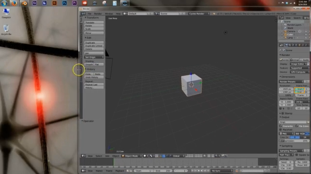

> Historical v2 audit: the zero-natural-repair result below belongs to the earlier rapid-retiming workflow. The current v3 release qualifies one separately selected natural terminal blink with an observed-state hold; [current release binding](../../evidence/steady-v3/release-binding.json). The original failures and counts below are preserved.

# Natural footage audit: preserve the teaching before offering a repair

A teacher often retains a flattened recording after losing its editable project. Frame Review asks for a smaller, checkable decision: is a rapid-changing region unwanted decoration, and can a local retime preserve the teaching around it? These tests show why both questions matter.

## What was selected before testing

Four additional licensed tutorial originals, each below the 64 MiB upload limit, with the same three nonoverlapping 12-second excerpts starting at 12, 40 and 68 seconds. The plan was saved before downloads. No defects were added, and no excerpt was shifted to obtain a positive. The sources are a convenience sample from a licensed-tutorial search, not a representative test set. They add 144 seconds of unaugmented footage; multiple excerpts of one video are not independent users or sources.

The original teacher and citation-screencast results remain separate: together there are six original lesson sources and fourteen selected unaugmented excerpts. The added-corner challenge is a disclosed controlled positive and is never counted as a natural repair.

## Measured baseline results

| Original tutorial | Candidates at 12 / 40 / 68 seconds | Exact original and prepared downloads |
|---|---|---|
| wikilink | 0, 0, 0 | 3/3 |
| tamil-install | 0, 0, 0 | 3/3 |
| blender | 0, 0, 1 | 3/3 |
| interface | 0, 0, 0 | 3/3 |

All twelve workflows reached review and were explicitly declined without approval or an edited artifact. Audio preparation correlation with the corresponding original excerpt ranged from 0.98909 to 0.99961 within a +/-10 ms search. This is a coarse lossy-preparation check, not original packet identity, speech intelligibility, language comprehension, or a listening study.

Eleven excerpts returned no candidate. That is not proof they contain no distraction. The frozen detector requires at least seven alternating luminance changes in a rolling second and a connected support of at least 64 pixels. Ordinary caret blinking, transient notifications and camera motion can be outside its scope.

The Blender excerpt at 68 seconds returned one candidate: [605, 181, 22, 12], 114 pixels, frames 40-315. Static inspection places it in the changing Blender settings panel. It must be treated as potentially useful instructional content, not automatically called a distraction. An actual HTTP plan protecting the settings column [560, 0, 80, 360] was refused for overlap, before an approval record or edited file existed. This is one contextual failure case, not a statistically estimated false-positive rate.

## Targeted natural camera-flicker stress case

A separate camera recording documents real exposure-dependent lamp flicker in a lecture hall. It is not an active lesson. The 902.57 MiB uploader original exceeds the product limit; the tested input is the explicitly identified, hash-recorded Commons 1080p transcode. A 720p derivative returned 404; the available input was obtained from the Commons video metadata API.

Fixed excerpts at 4 and 16 seconds produced three and five candidates. For each excerpt the largest support by pixel count was selected before attempting export. Both actual HTTP exports failed the unchanged bounded periodicity gate: "No repeated selected-pixel cycle passes the bounded periodicity gate." Neither exposed an edited artifact. The observed flicker is not a proven recurring decoration that this retimer can repair. Thresholds were not relaxed to manufacture a success.

## Product changes driven by these failures

The next runtime adds a required creator-declared teaching area for prepared lessons, enforced by the server as well as the interface. It explicitly asks the creator to check the smallest prepared labels and offers a full-size static prepared frame. The no-candidate outcome explains the detector's limits. A downloadable lesson decision record binds the selected excerpt, original/prepared hashes, candidate facts and final decision, including when no edit is made. A refused prepared edit now retains verified original/prepared downloads and a failure-aware decision record; the rejected edited download stays blocked.

These changes reduce ambiguity in the workflow. They do not establish semantic recognition or restore detail lost during 640x360 preparation. Qualification receipts for the revised runtime must be read separately from the baseline measurements above.

## Reproduce and judge the result

Use plan.json and sources.json to obtain the exact four originals and verify every SHA-256. Run audit_http.py inside the pinned image with a fresh output directory. Run targeted_http.py with the two relevant sources for the overlap and recurrence refusals. Scripts use the actual local HTTP service; no vision responses are stubbed. Baseline manifest identity and all per-excerpt outcomes are retained in the JSON files. Candidate images are static evidence, not playback verification.

The honest result is zero qualified natural lesson repairs so far. The strongest verified benefit remains bounded edit preservation on the disclosed controlled challenge. Real creator usefulness, readability and time saved remain unmeasured. A teacher trial and a naturally defective lesson that passes the unchanged gates are still needed before claiming real-world repair success.

This addresses the OpenCV competition's technical execution and failure-evidence requirements. Its 20% impact criterion still needs user benefit, not more synthetic positives. Meaningful AWS execution of the revised runtime remains pending while the account owner is away. No COOL or Agentic Vision award claim is made.
