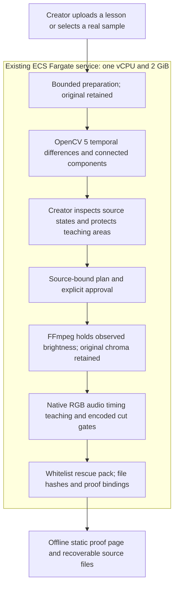

# Keep the repair reviewable / v11

A creator has a finished lesson and no editable project. A small caret blinks beside a number or changing command output. Frame Review proposes a bounded hold; the creator protects the teaching areas, inspects both observed states, checks the source-bound plan and explicitly generates a comparison.

The new rescue pack keeps that comparison inspectable after the job expires. Open `review.html`: every boundary and teaching PNG is embedded beside preservation checks, ordered teaching digests and relative artifact links. No script, external image, account or media playback is needed to inspect the page. Extract the ZIP to use its file links. It does not record creator acceptance or independently authenticate the server.

## Current evidence

All 14 Linux stages pass: 137 backend tests and 114 studio tests, one platform skip. The runtime manifest is `c92366d6d1a6753f0dc807fefe8a4adf8924ec5d4ce5b6e431ee744b366b6f88`, covering 117 files. Only the pack renderer, its test and artifact help text changed from v10. Detection, observed-luma/source-chroma mapping, encoding and preservation thresholds are unchanged.

Two selected untouched originals pass independent native HTTP/export/RGB/audio/timing/cut/tamper checks on this runtime. Current AWS HTTPS API tests repeat both uploads, reject an empty teaching plan and stale approval hash, explicitly approve a fresh plan, encode and download complete packs. Every media and proof PNG byte matches native qualification; all member hashes verify. Known-job requests without the owner session return 404.

| Selected original | Inside hold | Whole excerpt | Pack files |
|---|---:|---:|---:|
| French upload assistant | 5 → 0 | 8 → 2 | 50 |
| Joomla installation | 4 → 0 | 16 → 10 | 44 |

No newly timed threshold events. Activity counts adjacent selected-mean RGB changes of at least eight codes, not semantic events or human benefit. These are regression repeats of already selected v10 sources, not newly discovered lessons. The v10 eleven-case bank and 13-recording/91-window screen remain historical evidence with their original scope.

Separate startup-preflight replays hit bounded preparation `TimeoutExpired` errors, including an isolated French retry. Those failures are retained. Cold-start reliability is unresolved; no timeout or acceptance threshold was increased. The reproduction harness now places startup preflight before server creation, matching the application entry point.

Actual Brave component checks cover the local Joomla interface at 375/890, all 30 proof PNGs and fresh unchecked consent. The HTML extracted from the actual API-downloaded AWS French pack renders at 375/890 with all 36 embedded PNGs loaded. A loopback static server supplies that artifact for browser inspection. Current browser ZIP completion callbacks timed out and are not claimed passed. API artifact downloads, browser rendering and historical v10 browser-download success are separate evidence.

## Try the app

1. Choose Joomla installation and try the real prepared reading pause.
2. Inspect both observed states. Load and inspect the editable teaching areas.
3. Check the plan, explicitly tick review and generate a comparison.
4. Inspect all cut and teaching proofs, then download the rescue pack before expiry.
5. Extract it and open `review.html`; inspect the original, report and recipe before choosing an output.

For untouched originals, use the source URLs/hashes and exact rectangles in the case files and v10 source manifest. French: start 140, length 12. Joomla: start 60, length 12. Preparation changes picture/audio to 640×360/30fps with optional mono AAC once. Exact edit checks reference the prepared clip.

## Architecture

AWS ECS/Fargate `default-lesson-rescue:17`, image `sha256:a5764c521c41235519b1921ee8900fa509a1146880acc7e00e6e9c24cee34fdf`, completed as one running task. Owner cookies, CSRF/origin checks, one worker, eight-job capacity and resource/retention limits remain. No application task role or broader access was added. This is an app layer over the exact qualified v10 image, not a new cold dependency build. No COOL or special-award qualification is asserted.

## Reproduce

Build the root Dockerfile with the pinned runtime, then run `python studio/run.py --verify /tmp/new-verification` in Linux. Mount this document directory at `/audit` and hash-verified originals at their chosen paths. Run `python /audit/qualify-offline-v11.py /tmp/new-case /originals/upload-assistant.ogv 140 /audit/offline-v11-upload-assistant-case.json`. Use start 60 and the Joomla case file for its original. Adapt host mount paths. The included HTML verifier parses the saved page, matches embedded PNG hashes to its report and rejects active elements/external references. The API runner creates its own session and does not print tokens or cookies.

## Credits and limits

French source: Benoit Rochon, [Tutoriel de l'assistant d'import](https://commons.wikimedia.org/wiki/File:Tutoriel_de_l%27assistant_d%27import.ogv), [CC BY 3.0](https://creativecommons.org/licenses/by/3.0) as listed. Seconds 140–152 prepared/adapted; original SHA256 `f3fb18ff88451ed8e44b3a4ac080474a0d108cc3b08af3d0f8e3013d65af2c61`.

Joomla: VolodyA! V Anarhist, [Joomla Installation](https://commons.wikimedia.org/wiki/File:Joomla_Installation.vorb.theo.ogv), [Free Art License](http://artlibre.org/licence/lal/en) as listed. Seconds 60–72 prepared/adapted; original SHA256 `dcf4e35db5ada861d44ef0313083710c8397313885bc38afc901d8472475f83a`. No added defects or endorsement. Listed metadata is not independent rights clearance.

Only selected 1–12-second SDR excerpts, originals ≤64 MiB and at most 30 minutes. No full-lesson splice-back, original-resolution guarantee or moving semantic tracking. Preparation can reduce label legibility. Pixel preservation and portable proof are engineering properties. Teacher preference, time saved, attention, learning, accessibility, adoption and safety remain unmeasured. The existing video is historical and unchanged; real user audio remains deferred. No cron or PR.
