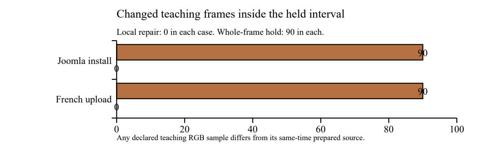
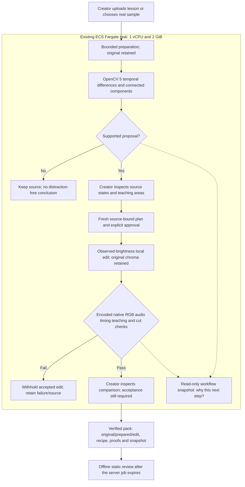

# Keep the teaching / v12

A creator has a finished lesson and no editable project. During a reading pause, a small caret blinks beside content that must keep changing. Frame Review proposes a local hold, asks the creator what must stay unchanged, and checks the encoded result before offering a comparison. It is not a full-lesson cleanup tool or an unwanted-motion classifier.

## New product behavior

“Why this next step?” explains the current evidence-driven route. No supported proposal recommends keeping the source; a proposal requests creator inspection; tools in progress request waiting; a bound, checked comparison requests final inspection; failure withholds the recommendation. Explicit generation approval is distinct from acceptance for use.

The owned `/api/jobs/<id>/workflow.json` download binds source, prediction, recipe and reported checks. The same snapshot enters the rescue pack as `vision-workflow.json`, under its file-hash manifest. It is a read-only current state, not a chronological event log, language-model reasoning or an independent verification. Existing server gates retain authority. The pack also contains the self-contained static `review.html` and all actual boundary/teaching PNGs.

## A comparison that tests the preservation promise

The independent video-only ablation encodes a whole-frame hold over the same interval, using the same observed reference as the local repair. This deliberately constructed counterfactual is not an accepted app output. The source recordings contain naturally occurring carets; no distraction was added to them.

| Selected real source | Source inside-hold activity | Local / whole-frame hold activity | Changed teaching frames: local / whole-frame hold |
|---|---:|---:|---:|
| French upload assistant | 5 | 0 / 0 | 0 / 90 of 97 |
| Joomla installation | 4 | 0 / 0 | 0 / 90 of 96 |

Activity counts adjacent selected-mean RGB changes of at least eight codes. A changed teaching frame means any sample in the union of declared teaching regions differs from the same-time prepared source; this includes codec variation. These are not semantic progress ticks, perceived distraction, preference or learning measurements. Both edits can remove the selected blink; only the local edit keeps every declared teaching RGB frame unchanged in these selected cases.

The accepted baseline passes an all-frame native-YUV roundtrip against its intended mapping. Source/local teaching digests match pinned Linux results. The first encoder omitted explicit raw-input color metadata and changed samples even at the reference frame; its initial counts were invalidated, not pooled. An earlier Windows FFmpeg 9 teaching-digest mismatch and a failed build-launch configuration remain recorded. The accepted comparison uses pinned Debian FFmpeg 7.1.5 in the actual v12 image.

## Current qualification

All 14 Linux stages passed in AWS CodeBuild: 137 backend tests and 119 studio tests, one platform skip. Both selected untouched originals passed startup preflight, actual HTTP preparation/approval/export/pack/tamper checks, independently decoded native/RGB/audio/timing/cut/teaching checks, and snapshot verification. Actual live AWS HTTPS API replays passed for both: 51-file French and 45-file Joomla packs, exact member hashes and native-qualified media/PNG bytes, fresh-plan approval, and 404 for unowned job/workflow/artifact requests.

Live Brave Joomla prepared-sample review, fresh unchecked consent, explicit generation and all 30 proof PNGs passed. The new panel fits at 375 and 890 widths; no horizontal page overflow. Actual browser ZIP completion remains separate and unqualified. API file saving requires no user assistance. All sources in this round are regression repeats; the older eleven-source bank and exploratory discovery screens remain historical, not a new held-out cohort.

Runtime: `lesson-rescue-workflow-2026-10-25-v12`, 119 files, manifest `87337c7b9caa164b741ede5f35d4fc471d6110ac4e985935c2651f6b883d51f1`. Image `sha256:dd6f6b6cdb4e3cc7ca624bc7ab761465566f66361a3f2539910a18cade5be7e6`. Only the workflow module, interface, pack inclusion and associated tests changed from v11. Detection, encoding and preservation thresholds are unchanged.

AWS ECS/Fargate `default-lesson-rescue:18` completed as one 1-vCPU/2-GiB task; one worker/eight jobs, owner isolation, CSRF/origin checks, bounds and retention remain. No app task role or production resource expansion. The temporary CodeBuild qualification policy was removed. This is an app layer over the exact v11 image, not a cold dependency rebuild. Native startup-preflight successes in CodeBuild do not erase earlier WSL/preparation failures or prove general cold-start reliability.

## Judge route

1. Choose Joomla installation and try the real prepared reading pause.
2. Read “Why this next step?”, inspect both observed states, and load/inspect the three editable teaching areas.
3. Check a fresh plan, explicitly tick review and generate a comparison. Suggestions never approve an edit.
4. Inspect the cut proofs, teaching timelines and the updated workflow snapshot. Generating a comparison is not acceptance for use.
5. Keep the pack before expiry. Extract it, open `review.html`, verify `manifest.json`, and inspect source/recipe/report before choosing an output.

## Architecture

## Reproduce

Build the root Dockerfile using its pinned image, Debian FFmpeg and locked dependencies, then run `python studio/run.py --verify /tmp/new-gate` in the Linux image. Its 14 stages include real examples and an actually encoded bad Jupyter boundary regression that must fail acceptance.

Mount this document directory at `/audit`, the hash-verified originals at `/originals`, and a writable empty evidence directory at `/evidence`. For the French original run `python /audit/qualify-workflow-v12.py /evidence/new-french /originals/upload-assistant.ogv 140 /audit/upload-assistant-case.json`. Joomla uses `joomla-install.ogv`, start 60, and `joomla-case.json`. These scripts reproduce the original native audit layout inside the image. The HTML verifier checks every embedded PNG hash and excludes active/external assets.

For the independent counterfactual, save the resulting packs as `upload-assistant-AWS-Rescue-Pack.zip` and `joomla-AWS-Rescue-Pack.zip` in a directory mounted at `/packs`. Set `FRAME_ABLATION_PACK_ROOT=/packs` and `FRAME_ABLATION_OUTPUT=/evidence/new-ablation`, then run `python /audit/compare-whole-frame-hold.py`. It rejects a nonexact native baseline or a source/local teaching digest mismatch before accepting results. Counterfactual videos contain no audio and are diagnostic artifacts only.

## Sources and limitations

French: Benoit Rochon, [Tutoriel de l'assistant d'import](https://commons.wikimedia.org/wiki/File:Tutoriel_de_l%27assistant_d%27import.ogv), [CC BY 3.0](https://creativecommons.org/licenses/by/3.0) as listed. [Original](https://upload.wikimedia.org/wikipedia/commons/9/9e/Tutoriel_de_l%27assistant_d%27import.ogv), SHA-256 `f3fb18ff88451ed8e44b3a4ac080474a0d108cc3b08af3d0f8e3013d65af2c61`; seconds 140–152 prepared/adapted. Local edited SHA-256 `97310fcc314affbc74da4c3b3d5dd02b38c9878bf66cc8e39c1d8ccb1e656394`.

Joomla: VolodyA! V Anarhist, [Joomla Installation](https://commons.wikimedia.org/wiki/File:Joomla_Installation.vorb.theo.ogv), [Free Art License](http://artlibre.org/licence/lal/en) as listed. [Original](https://upload.wikimedia.org/wikipedia/commons/0/05/Joomla_Installation.vorb.theo.ogv), SHA-256 `dcf4e35db5ada861d44ef0313083710c8397313885bc38afc901d8472475f83a`; seconds 60–72 prepared/adapted. Local edited SHA-256 `7a5202e860238ad055b1ad981a19806a1dc922396a556e2c0eebb726e96a506b`. Credits and adaptations remain in the pack. Listed metadata is not independent rights clearance or endorsement.

Only selected 1–12-second SDR excerpts; originals at most 64 MiB. Preparation changes resolution, picture/audio and can lose label detail. Exact checks reference prepared bytes. No original-resolution guarantee, full-lesson splice-back or semantic moving tracking. No measured teacher preference, time saved, attention, learning, accessibility, adoption or safety. No COOL or special-award eligibility assertion. Existing video unchanged; the new demo waits for user audio. No cron or PR.
