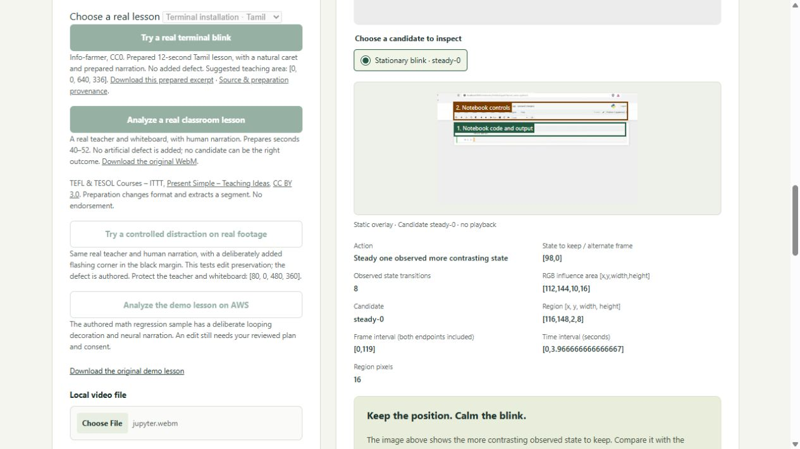
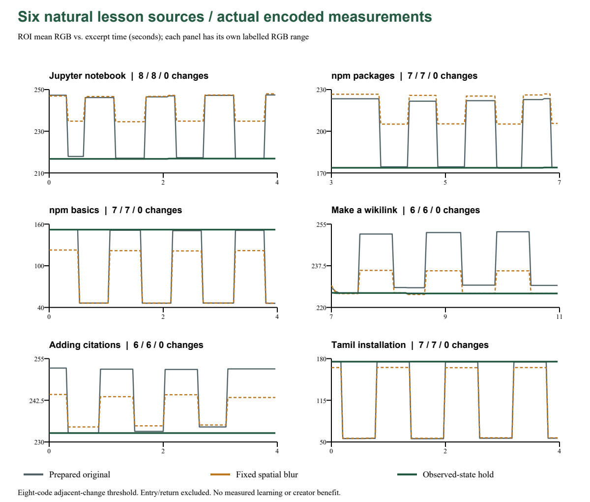

# Frame Review: Keep the Lesson

**Keep the code. Calm the blink.** A teacher has the finished recording, but no editable project. Frame Review lets the editor hold one observed blinking detail during a reading pause, with the code, command, timeline and prepared narration checked against the exported file.

[Live AWS app](https://le-d72c965de52749b08fd72a2513bccce1.ecs.us-east-1.on.aws) · [Devpost entry](https://devpost.com/software/countback-inspect-the-evidence) · [Technical report](../docs/real-lessons-report.pdf)

[Two checked AWS output videos and their credits](../docs/natural-v4/examples/README.md) are included for offline inspection or local HTTP playback.

**Verified 23 October: six selected natural lesson sources now complete untouched-original upload → preparation → reviewed plan → checked export → exact downloads.** No defect was added. The selected intervals contain **41 adjacent ROI-mean changes before, 41 after one fixed spatial blur, and 0 after the reviewed holds**. Every declared teaching region was exact across all 360 prepared frames; prepared audio and timing passed. These are mechanical results on selected four-second intervals, not a learning or creator-benefit study.

Three new sources came from a predeclared four-source/twelve-excerpt convenience cohort. Two are repairs of earlier development failures; the sixth repeats the previously qualified Tamil source. The bundled presets and AWS reruns are the same sources, not more independent successes.

The cases have concrete teaching contexts: Jupyter's empty next-cell caret sits below the completed code/output; npm packages has an empty search-field caret above the repository explanation; the wikilink lesson has an empty edit-summary caret below its instructional textarea. These are plausible reading-pause edits to inspect, not automatic labels of unwanted motion.



Alex The Analyst, via Wikimedia Commons, CC BY 3.0 as listed on its file page; imported YouTube license review is marked not yet reviewed. Extracted, resized and re-encoded; no defect added. No endorsement.

## Try three real lessons

1. Open the app and choose **Jupyter notebook · English**, **npm command line · English**, or **Terminal installation · Tamil**. Start its real-lesson example.
2. Inspect both observed states. A caret can convey teaching information; choose a stationary reading pause where the blink can change.
3. Add named teaching rectangles, then **Check edit plan**. Suggested areas are below and in each source-credit download.
4. Explicitly **Generate comparison**. Inspect all twelve boundary crops, protected teaching/audio checks, and entry/return warnings.
5. Download and play the edited comparison before deciding whether to use it. Preparation and passing checks do not approve publication.

| Preset | Named teaching rectangles [x,y,width,height] | Expected source → hold count |
|---|---|---:|
| Jupyter | Code/output `[52,96,552,45]`; controls `[50,30,560,60]` | 8 → 0 |
| npm command line | History `[0,0,480,236]`; command `[0,232,530,28]`; presenter `[490,0,150,160]` | 7 → 0 |
| Tamil installation | Command text `[0,0,640,336]` | 7 → 0 |

Presets are disclosed prepared twelve-second excerpts. For ordinary **original-file intake**, obtain the hash-checked original from [source credits](../evidence/natural-v4/sources.json), upload it with preparation checked, and use the excerpt start in the table below. The full uploaded original and prepared source have separate hashes and downloads. Jupyter and npm basics were also verified through actual original uploads in the public AWS browser.

## Six encoded comparisons

Counts are adjacent ROI-mean RGB changes of at least eight codes **inside each approved interval**, excluding entry and return. All six intervals are 120 frames at 30 fps; the whole prepared excerpt is twelve seconds.

| Untouched original | Prepared excerpt | Reviewed frames | Source | Fixed blur | Hold |
|---|---:|---:|---:|---:|---:|
| Jupyter notebook | 301–313 s | 0–119 | 8 | 8 | 0 |
| npm packages | 29–41 s | 90–209 | 7 | 7 | 0 |
| npm basics | 232–244 s | 0–119 | 7 | 7 | 0 |
| Make a wikilink | 60–72 s | 210–329 | 6 | 6 | 0 |
| Adding citations | 24–36 s | 0–119 | 6 | 6 | 0 |
| Tamil installation | 68–80 s | 0–119 | 7 | 7 | 0 |



The fixed reference is one untuned 5×5 Gaussian / sigma 2 blur of native luma in the same box and interval, retaining source chroma. It is not a complete professional editor comparison. [Continuous traces, peak-to-peak range, RMS and reference-state contrast](../evidence/natural-v4/comparison.json) accompany the count. A steady value alone does not prove a good edit.

For Jupyter, ROI-mean peak-to-peak range is **30.542 RGB codes in the source, 13.417 after blur, and 0.146 after the hold**. The kept reference state's mean contrast against its surrounding ring is 30.333 codes in both source and hold, versus 12.333 after blur. This measures preserved local contrast, not readability or user preference. Exact native held samples can still decode with small RGB variations because interpolation depends on unchanged neighbours; the largest hold range across these cases is 0.306 codes.

**The return can get worse.** Jupyter's selected-mean return diagnostic increases from approximately 0.00021 to 0.23028; the app prominently warns that a strong return was introduced. All six entry/return measurements remain in their receipts. This is a reviewed tradeoff, not a safety or accessibility result. Attention, comprehension, time saved, adoption and user preference remain unmeasured.

Independent decoders verified native samples outside each box, the exact observed-state mapping, all 240 outside-interval frames, all declared teaching RGB samples across 360 frames, RGB outside the influence area and prepared audio. All six original/prepared/output downloads and twelve boundary HTTP crops passed hash checks. The public AWS Jupyter/npm browser outputs match these independently decoded local outputs, and both downloaded exports played through twelve seconds without a media error. Listening was not evaluated.

## What changed after real failures

- Low-contrast compressed browser carets failed the older stationary proposal rule. `steady-proposal-v2` admits bounded two-state variation with range at least 24, state separation at least 12, and mean-error allowance `max(2,min(6,0.15×separation))`. The maximum native sample error remains 16; encoded preservation gates stay exact.
- A stopped/moved caret could leave a long inactive tail. A maximum dwell of 60 frames now applies to every run, including the endpoints. A full twelve-second citations proposal is rejected; a supported four-second interval remains. Dedicated numerical positive/negative regressions cover these cases.
- A real silent VP8 Cangjie lesson exposed center-sited chroma that the prepared stream still advertised as center. Preparation now converts chroma location to left and probes the output before analysis. The same original now reaches review, produces no supported proposal, and recovers its exact original/prepared files and no-edit decision. Its earlier failure is preserved.
- A browser test caught a completed Jupyter example linking to the terminal credit. The link now follows validated example identity, and actual downloaded provenance is checked against the prepared input. UTF-8 response headers also remove the earlier corrupted punctuation.

The new timing grid was declared before outcomes were inspected: quarter, half and three-quarter source duration, floored and capped at 600 seconds. Three of twelve excerpts proposed a repair; all nine other outcomes are retained. Final code was iterated after inspection using development sources, so this is **development evidence, not a held-out benchmark or representative recall estimate**. [Plan](../evidence/natural-v4/selection-plan.json) · [All twelve outcomes](../evidence/natural-v4/cohort.json) · [No-edit recovery](../evidence/natural-v4/no-edit-recovery.json).

The older rapid retimer's six-source/fourteen-excerpt zero-success audit, Blender teaching-content refusal, natural camera recurrence failures and controlled added-corner positive remain dated history in [the earlier audit](../docs/natural-lessons/README.md). The one-case [v3 release](../evidence/steady-v3/release-binding.json) and its failures are retained.

## OpenCV and reproducibility

OpenCV 5 performs connected-component localization, review overlays, encoded RGB crops, error histograms and teaching-region measurements. NumPy holds native YUV samples and mappings; FFmpeg prepares and encodes the media. A separate stationary two-state proposal requires small support, repeated transitions, bounded dwell/error and supporting chroma stability. The action holds an actual observed state with greater local contrast. It does not recognize an unwanted distraction or generate a replacement image.

Approval binds source, both analyses, implementation, proposal and named teaching rectangles. The worker recomputes the proposal. Protection overlapping the four-pixel influence area, stale plans, changed sources or failed encoded checks withhold the edited download. Source and decision recovery remain available. The original rapid-change detector and periodic retimer remain frozen.

Run these commands from the repository root:

```sh
docker build -t frame-review .
docker run --name frame-review-check --network none frame-review python studio/run.py --verify /tmp/qualification
docker cp frame-review-check:/tmp/qualification ./qualification
docker run --rm --network host frame-review python studio/run.py --serve --port 8877
```

Open http://127.0.0.1:8877 on the Linux Docker host. All **thirteen stages passed**, including 137 backend tests and 78 studio tests (one Linux platform skip), three natural preset exports, silent WebM intake, duration/audio/pixel refusals and real classroom/controlled integrations. Windows source/UI checks are separate from Linux media qualification. Use new output/container names. [Original/cohort reproduction](../docs/natural-v4/README.md) · [Full gate](../evidence/natural-v4/verification.json) · [Exact release binding](../evidence/natural-v4/release-binding.json) · [AWS/browser checks](../evidence/natural-v4/cloud-verified.json).

## AWS delivery and limits

ECS/Fargate performs the actual preparation, OpenCV analysis and FFmpeg export behind managed HTTPS. ECR pins the image; CloudWatch records the service. The completed rollout runs one task, one worker and eight job slots. [Deployment instructions](../docs/DEPLOYMENT.md).

- Manifest: `21fb29c79616e9afebdcfc0176e4ddd44c3be83b3b58386793b9d2623f4a93d0` — 103 exact runtime files.
- Image: `sha256:196b508dcd7314e26f5d69d0fd82470821793f6de3c437d14bb7448da9d93eaf`.
- Build: `lesson-rescue-natural-cohort-2026-10-23-v4`.

MP4/MOV/WebM intake is capped at 64 MiB, supported 8-bit SDR video up to 3840×2160 and one supported mono/stereo audio track. Excerpts start at 0–600 seconds and last 1–12 seconds. **There is no full-lesson splice-back.** Preparation resizes/letterboxes to 640×360, converts to 30 fps, and encodes H.264 and optional mono 48 kHz AAC once. It changes picture/audio and can erase small teaching detail. Exact edit checks reference the prepared clip, not the uploaded original. Fixed rectangles do not track objects or establish legibility.

The worker runs as UID 10001 with process/time/memory/disk caps and restricted file/pipe protocols. Secure/HttpOnly/SameSite cookies and host/origin/request-token checks scope jobs. No application AWS API role is needed. Inactive jobs expire after 24 hours; restart/deployment can clear them sooner. Known multimedia package findings remain; mitigations are not certification.

Developed by Joseph Ayanda with AI assistance. Licensed media has separate source credits and obligations; no author endorsement. The existing 2:46 video shows an earlier workflow with disclosed neural narration. Joseph's final real-voice recording, creator trials and competent manual-editor comparisons remain outstanding. No COOL or Agentic Vision award claim is made.
