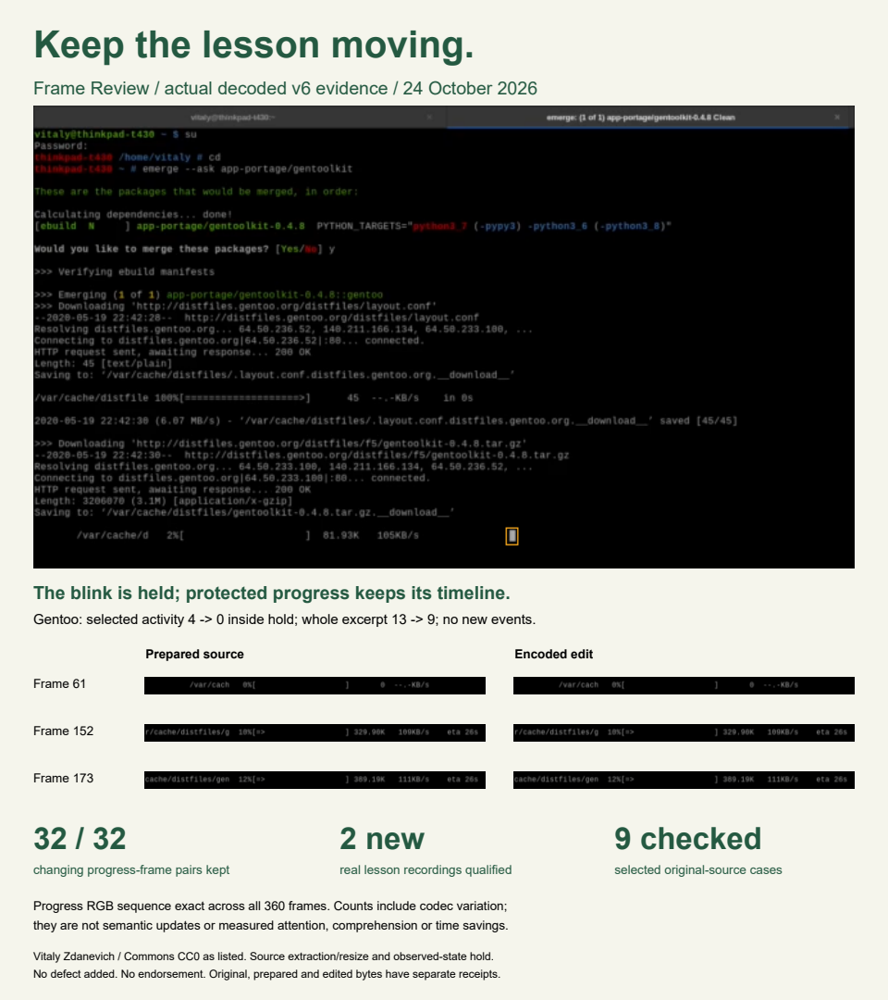

# Frame Review: Keep the Lesson

**Keep the lesson moving. Calm the idle blink.** A teacher has a finished screen recording, but the editable project is gone. Frame Review helps an editor hold one observed blinking detail during a reading pause while the explanation, code, progress readout and prepared narration keep their original timeline.

[Live AWS app](https://le-d72c965de52749b08fd72a2513bccce1.ecs.us-east-1.on.aws) · [Devpost entry](https://devpost.com/software/countback-inspect-the-evidence) · [Technical report](../docs/real-lessons-report.pdf) · [Two new real-source comparisons and credits](../docs/natural-v6/examples/README.md)

**v6 adds proof of what keeps changing.** Each protected teaching area has a frame-ordered RGB digest over all 360 decoded frames, source/edit change counts, and hash-bound static PNG pairs at hold entry, the largest measured teaching change, and hold end. A teaching freeze or reordered sequence fails even when a simple change count matches. Damaged proof receipts or PNGs are withheld. Download hashes and actual decoded crops are independently checked.

In the existing Gentoo package tutorial, the protected progress readout changes in **32 of 112 adjacent frame pairs during the hold, in both source and edit**, with the complete ordered sequence exact. These are decoded sample changes, including codec variation; they are not 32 semantic progress updates. The selected blink goes 4 → 0 inside the hold; whole-clip activity goes 13 → 9, including cuts. Gentoo is silent; audio absence stays exact.

## Two additional real recordings, nine total qualifications

This round screens **11 additional originals / 33 fixed windows** and qualifies two reviewed idle-caret examples: Free I.T. Athens' Writer explanation and a Portuguese Wikipedia image-caption lesson. Seven prior sources pass regression with the new proof. No visual distraction was added. Nine qualifications are selected source cases, not nine users, independent creators, a general success rate or demonstrated preference.

| Lesson | Original start (s) | Inclusive hold frames | Inside hold | Whole 12 s | Teaching PNGs |
|---|---:|---|---|---|---:|
| jupyter | 301 | 19-97 | 4 → 0 | 24 → 18 | 12 |
| npm-packages | 29 | 117-205 | 5 → 0 | 19 → 13 | 6 |
| npm-basics | 232 | 1-97 | 5 → 0 | 17 → 11 | 16 |
| wikilink | 60 | 225-314 | 4 → 0 | 9 → 3 | 12 |
| wiki-citations | 24 | 10-92 | 4 → 0 | 6 → 2 | 12 |
| terminal | 68 | 6-95 | 4 → 0 | 15 → 9 | 6 |
| gentoo-equery | 62 | 61-173 | 4 → 0 | 13 → 9 | 18 |
| libreoffice-writer | 150 | 1-119 | 6 → 0 | 15 → 9 | 18 |
| wiki-userpage | 236 | 244-354 | 5 → 0 | 17 → 11 | 24 |

The activity metric counts adjacent selected-box mean RGB changes ≥8 codes. Whole-excerpt counts include cut points. All nine have zero newly timed threshold crossings and all encoded boundary/preservation gates pass. Static moments alone do not show full motion. Fixed teaching regions are creator declarations, not a semantic guarantee.

## Keep the useful motion; refuse edits on teaching content

Three real detections in the first screen touch a configuration-menu command, the first letter of a document title, and a schedule dataset. Actual HTTP plans refuse when those teaching areas are protected, with exact original/prepared downloads and edited downloads withheld. The source-selection plans, all 33 outcomes, and the failed test-label request are retained in [v6 evidence](../evidence/natural-v6/).

The first seven-source/21-window screen ran on frozen v5; the four-source/12-window follow-up ran on v6. The detector and cut policy are unchanged between them. The second round is exploratory, selected after the first round, not held out. Three Toybox recordings share one author. Additional rapid-change proposals in equation annotation and Wikipedia editing were declined; proposal presence does not identify a distraction.

## The cut-point fix stays enforced

The frozen `steady-boundaries-v1` policy trims at most 30 frames per end, never extends a detection, and keeps the first/last clip frames unchanged. Actual encoded entry, return and loop diagnostics must be no worse than source in selected/influence RGB mean absolute, RMS and maximum error, plus the frozen selected-mean diagnostic. No tolerance or detector threshold was relaxed for the new examples.

The prior six-source comparison remains **the same 72 seconds**: source 90, fixed blur 91, prior longer hold 54, source-matched hold 56 changes. The matched hold removes 34 (37.8%) with zero new events; the prior hold introduces events in five cases. The matched intervals total 17.6 seconds versus 24 before. This is an engineering comparison, not superiority over a professional editor or a human-benefit trial. [Full v5 traces and negatives](../evidence/natural-v5/comparison.json) remain versioned.

## Try and reproduce

The live app has prepared Tamil terminal, Jupyter and npm examples with source/provenance links. Inspect both states, declare the teaching areas, check the plan, explicitly generate a comparison, then review the actual download. Original/prepared bytes and receipts are separate. The [new case configurations](../docs/natural-v6/) supply exact original starts, rectangles and expected results; listed source URLs and hashes are in evidence/natural-v6/sources.json.

Build on Linux: `docker build -t frame-review .`

Run the full gate in a fresh container: `docker run --name frame-review-check --network none frame-review python studio/run.py --verify /tmp/qualification`, then `docker cp frame-review-check:/tmp/qualification ./qualification`.

Serve: `docker run --rm --network host frame-review python studio/run.py --serve --port 8877`, then open http://127.0.0.1:8877 on that host. Windows source/UI checks alone do not qualify media. All **14 stages**, **137 backend unit tests**, and **91 studio tests** pass (one platform skip). The old bad Jupyter boundary is actually encoded and refused. The runtime manifest binds **108 exact files**: `09c8bd44526e7d1e65ad40ea2528154b3f6489c7659510bb61b5fcd5fddfa123`.

AWS revision 11 is complete. Actual original-upload Gentoo, Writer and caption browser jobs pass artifact/PNG hashes, ownership checks, reload and twelve-second downloaded playback. The caption pair has different prepared video bytes across hosts and was independently decoded against its actual cloud reference; audio packets/PCM match. This is not universal cross-host preparation determinism. See the versioned cloud receipt and diagnostic negative. Actual 375/890 widths were checked on caption; Gentoo/Writer were observed at 1280.

## Scope and next evidence

Supported SDR originals up to 64 MiB; prepared 1–12 second excerpts at 640×360/30 fps (or canonical 320×180). Preparation resizes/re-encodes picture and optional mono AAC once and can reduce legibility. Exact edit checks compare against the prepared clip. Native samples outside the box, every outside-interval frame, RGB outside influence, all protected RGB, timing and prepared audio must remain exact. No full-lesson splice-back or moving semantic tracking is implemented.

No measured creator time saving, preference, attention, comprehension, accessibility, adoption, medical or safety benefit. A useful caret may stay; the creator decides. Next useful human evidence is a consenting teacher/editor comparison with blinded preference and timed rescue tasks. Source metadata preserves listed authors, license URLs and adaptations; imported license claims are not independent clearance or endorsement. Wikipedia output is CC BY-SA 4.0 as listed; Writer is CC BY 3.0. Earlier failures and controlled added-corner tests remain explicitly separate.

The 2:46 neural-narrated demo covers an earlier workflow. Current evidence is in this report, source, actual artifacts and live app. Joseph's real voice is deferred. Existing submission is updated in place; no cron or new PR is part of this release.
