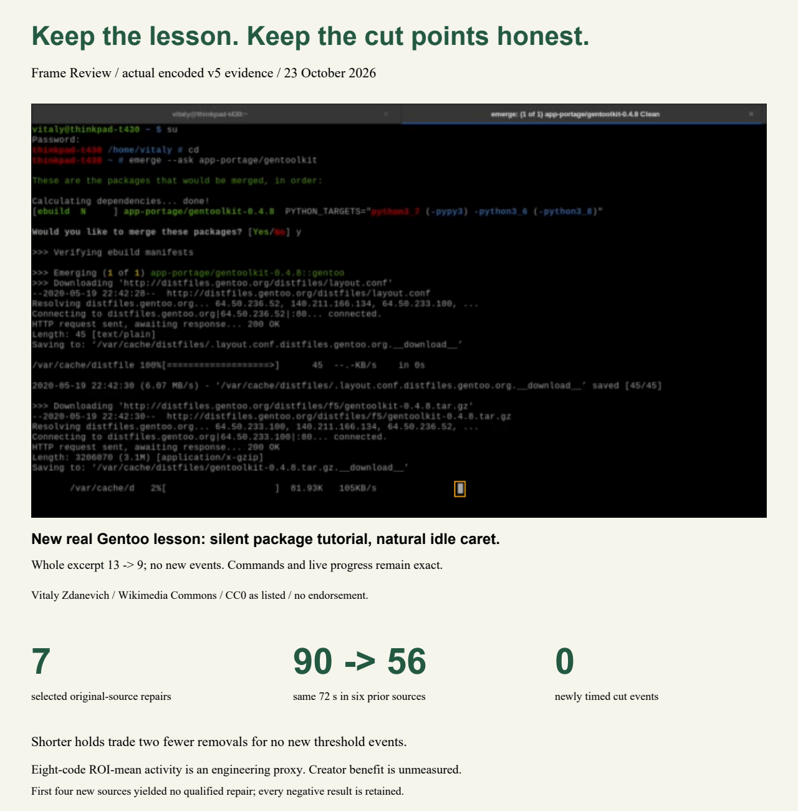

# Frame Review: Keep the Lesson

**Keep the code. Calm the blink. Keep the cut points honest.** A teacher has a finished screen recording and no editable project. Frame Review lets an editor steady one observed blinking detail during a reading pause, while protecting the command, code, progress readout and prepared narration on the original timeline.

[Live AWS app](https://le-d72c965de52749b08fd72a2513bccce1.ecs.us-east-1.on.aws) · [Devpost entry](https://devpost.com/software/countback-inspect-the-evidence) · [Technical report](../docs/real-lessons-report.pdf) · [Checked output videos and credits](../docs/natural-v5/examples/README.md)

**23 October v5: seven actual original-source HTTP repairs pass independent encoded checks.** Six repeat the prior lessons to fix their cut points; the seventh is a new, silent Gentoo package-management tutorial found with the code already frozen. No visual defect was added. These are selected engineering experiments, not seven users or a general success rate.

Across the **same 72 seconds in the six regression excerpts**, adjacent selected-region mean RGB changes of at least eight codes fall **90 → 56 (34 fewer, 37.8%)**, including the cuts. There are **zero newly timed threshold crossings**. All three boundary diagnostics—entry, return and loop—are no worse than source in selected/influence RGB mean absolute, RMS and maximum error, plus the frozen selected-mean linear diagnostic. All named teaching pixels, native samples outside the box, outside-interval frames, timestamps and prepared audio checks pass.

These counts measure local temporal activity. No attention, comprehension, creator time saving, accessibility, medical, safety, adoption or publishing-clearance benefit has been measured. The editor must decide whether a caret conveys useful information and inspect the actual download.

## The boundary failure and causal fix

The previous fixed four-second holds could make an exit worse. The new `steady-boundaries-v1` policy trims at most 30 frames from each end and chooses an actual source frame from the same more-contrasting appearance class. It never extends the proposed window or invents pixels. The clip's first and last frames stay untouched. At least two seconds and four internal changes must remain useful to hold.

The proposal predicts the cuts, then an independent decoded-export gate checks the actual selected box and influence area. A worse cut, a newly timed eight-code event, changed teaching samples, altered prepared audio or a stale approval withholds the edited download. The decision record includes these measurements. The UI now shows whole-excerpt counts and the encoded cut-point result.

**The tradeoff stays visible:** prior longer holds leave 54 changes versus 56 with the shorter matched holds, but introduce new threshold events in five cases. The new holds total **17.6 seconds**, versus 24 seconds before. Their interior counts are 26 → 0; the older 41 → 0 counted different intervals. These are not interchangeable comparisons. Existing strong source motion and loop seams can remain.

## Same-excerpt encoded comparison

All rows use a full twelve-second excerpt, 360 frames at 30 fps, and the same selected box. The fixed blur uses one untuned 5×5 Gaussian, sigma 2, inside the new interval with source chroma retained. It is one engineering reference, not a complete professional editor or a user trial. [Full traces, new-event times and continuous temporal/contrast measurements](../evidence/natural-v5/comparison.json) accompany the count.

| Lesson | Start (s) | New inclusive frames / reference | Source | Fixed blur | Prior hold | Matched hold |
|---|---:|---|---:|---:|---:|---:|
| jupyter | 301 | 19–97 / 67 | 24 | 24 | 17 | 18 |
| npm-packages | 29 | 117–205 / 116 | 19 | 20 | 13 | 13 |
| npm-basics | 232 | 1–97 / 0 | 17 | 18 | 11 | 11 |
| wikilink | 60 | 225–314 / 251 | 9 | 8 | 3 | 3 |
| wiki-citations | 24 | 10–92 / 79 | 6 | 6 | 1 | 2 |
| terminal | 68 | 6–95 / 24 | 15 | 15 | 9 | 9 |

Totals: source 90; fixed blur 91 (new events in two cases); prior hold 54 (new events in five cases); matched hold 56 (no new events). A lower total alone does not establish a good edit.

## New lessons, including the negatives

The unchanged build was frozen before screening **seven new sources / 21 preselected windows**. Four broad instructional sources were screened first; the three command-line sources were an exploratory follow-up chosen after those results. This is a convenience sample, not held-out recall.

| New source | Actual outcome |
|---|---|
| Ezhil loops/turtle | Three review windows, no proposal |
| GeoGebra matrix | Three declared source-dimension refusals; limit unchanged |
| Phoneme table | Two review/no-proposal windows; one >16-region refusal |
| WikiSound recording | Two no-proposal windows; one with two rapid candidates in instructional Audacity controls/readouts. Both refuse when protected; exact original/prepared recovery passes. |
| Git Foundations setup | Two no-proposal windows; one with eight rapid candidates in the tutorial webpage. Declined; these are not stationary-detail repairs. |
| Toybox true/false | Three review windows, no proposal |
| Gentoo equery | One stationary caret proposal; two no-proposal windows. New full HTTP repair qualified at 62 seconds. |

Two previously negative editor recordings were also screened over twelve nonoverlapping windows without proposals. Those are exploratory offline detector screens, not twelve HTTP repairs. Every outcome is retained in [v5 evidence](../evidence/natural-v5/).

**New Gentoo case:** untouched original → prepared seconds 62–74 → reviewed box `[370,330,6,10]` → frames 61–173, source reference 86 → encoded export/download. Whole-excerpt activity **13 → 9**, interior **4 → 0**, no new events. Commands and the live progress readout remain exact in every frame; all other preservation and boundary gates pass. The original is silent and audio absence stays exact. Its existing entry remains strong (selected-mean diagnostic about 0.21815 → 0.21686); passing no-worsening does not make it smooth. Vitaly Zdanevich, CC0 via Wikimedia Commons as listed; no endorsement.

## Try and reproduce

1. Open the AWS app and choose Jupyter, npm or the Tamil installation example. These are disclosed prepared excerpts, not additional sources. The app only shows static images.
2. Inspect both observed states. For Jupyter protect code/output `[52,96,552,45]` and controls `[50,30,560,60]`. For npm protect history `[0,0,480,236]`, command `[0,232,530,28]`, presenter `[490,0,150,160]`. For Tamil protect `[0,0,640,336]`.
3. Check the plan and explicitly generate the comparison. Inspect twelve boundary crops, the whole-excerpt card, encoded cuts, teaching areas and audio checks. Download and play the output before deciding whether to use it.
4. For original intake, obtain hash-checked files from [source credits](../evidence/natural-v5/sources.json), upload with preparation checked, and use the starts above. Gentoo uses [the exact case configuration](../docs/natural-v5/natural-v5-gentoo-case.json). Originals stay separately downloadable; exact edit checks reference the resized/re-encoded prepared input.

AWS original uploads of **Jupyter, npm basics and Gentoo** were checked in the real browser: approval, actual artifact downloads and hashes, twelve crop downloads, reload, responsive layouts and downloaded H.264 playback. They repeat local cases; they are not extra independent successes. Playback was muted, so this does not establish listening quality. Known-job reads without the owner cookie return 404. Receipts: [cloud verification](../evidence/natural-v5/cloud-verified.json).

Build on Linux with `docker build -t frame-review .`. Run the gate with `docker run --name frame-review-check --network none frame-review python studio/run.py --verify /tmp/qualification`, then `docker cp frame-review-check:/tmp/qualification ./qualification`. Use a fresh container name. Serve with `docker run --rm --network host frame-review python studio/run.py --serve --port 8877` and open http://127.0.0.1:8877 on the Linux Docker host.

All **14 stages** pass, including the actual encoded old-Jupyter boundary rejection. Backend: 137 unit tests; studio: 84 tests (one platform skip). The final CLI sentence retains the older “Thirteen” wording; the authoritative verification JSON contains fourteen passed stages. The first gate hit a frozen PID-marker test race; a full rerun passed with that test unchanged. A development Wikilink CPU refusal and rejected floating-point optimization remain documented. No runtime limit or error budget was increased.

Runtime source manifest: `a900388b23d5cdab6f2ad590a669fed2d70e50eee32ef20891b33a7249ca5ac1` / **106 exact files**. AWS ECS Fargate, digest-pinned ECR, managed HTTPS, one vCPU / 2 GiB task, CloudWatch logs, one worker/eight job slots, 24-hour ephemeral owned jobs, no application AWS role. Source and [container instructions](README.md) are included. The older `opencv-ready/` package remains frozen history.

## Why this fits the hackathon

OpenCV 5 connected components localize support; native luma/chroma checks establish the observed states; OpenCV measures RGB preservation and encoded boundary errors. FFmpeg handles bounded preparation/export, and NumPy represents samples. This is a concrete creator editing operation with a source-bound human decision, an inspectable refusal and a complete AWS media path. Technical execution, innovation, impact, UX, documentation and cloud reproducibility have separate evidence; the rubric is not a score received.

The near-term impact hypothesis is rescuing a short explanation without re-recording or rebuilding its timeline. It still needs creator preference and timed-task studies with consenting educators. No such result is claimed. The existing narrated walkthrough covers the earlier workflow; the real-voice recording is deferred as requested. The current report and receipts describe v5. No handoff documents or credentials are tracked; direct default-branch publication is used, with no cron work.
